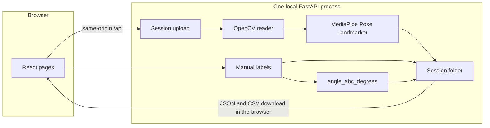

# Review feedback and action plan

This note answers six review areas for the PaceFrame capstone. The repository does not contain the panel's original comments, so this file does not quote the panel and does not claim that a change was made because of a particular comment.

"Verified current evidence" means a file or stored result that was inspected. "Actual improvement" means something present in local commit `81d6b0a` that was not in the older prototype commit `f72032d`. "Pending" means it is still not a delivered result.

The coach note is one informal consultation. It is not eight interviews. The completed measurement is an unsigned image-plane angle. It is not a validated 3D measurement.

## Architecture

The browser is a React application. Its routes are upload, session, pose review, event annotation, knee measurement, and the analysis report (`frontend/src/App.tsx`). In development, Vite serves the page on port 5173 and proxies `/api` and `/health` to one FastAPI process on `127.0.0.1:8000`.

FastAPI accepts one video, reads it, and stores a session. OpenCV opens the file, counts decoded frames, and supplies frame images. It does not decide bowling events.

MediaPipe is isolated in `backend/app/pose/mediapipe_estimator.py`. It uses the Pose Landmarker Tasks API and the local model file `backend/models/pose_landmarker_full.task`. That model is gitignored. A missing pose stays missing. The application does not borrow a neighbouring frame.

A person marks events on the decoded frame that is actually displayed. Back-foot contact is optional. Front-foot contact and release are required. The person chooses the bowler's anatomical front leg, left or right, and confirms it. The picture does not decide the side. Nothing is written until the person saves. `search_contact_candidates` is not called by the API. Automatic event detection is not part of this workflow.

The measurement uses `angle_abc_degrees` in `backend/app/biomechanics/geometry.py`. It is the unsigned interior angle at the knee, from the hip and ankle pixel points, in the range 0 to 180 degrees. It is not a signed angle, not a 3D joint angle, and not an injury or coaching score. If the hip, knee, or ankle is missing, the status is `unavailable` and the angle is null, not zero. Stored evidence uses schema `front-knee-evidence-v1`, described in `docs/measurement_validation/MEASUREMENT_EVIDENCE.md`. Recomputing the angle from the stored pixels checks the arithmetic. It does not prove that the pixels sit on the joint.

Sessions are folders under `backend/local_sessions`, or under `FAST_BOWLING_SESSION_ROOT` when that variable is set. Each id is an opaque 32-character hex value. The folder can hold the video, manifest, manual labels, pose-review files, and `measurement/report.json`. Those folders are gitignored. There is no login. A session id is not permission to view someone else's video.

JSON and CSV downloads are built in the browser from the stored report. The JSON file is named from the anonymous bowler and delivery ids. The CSV file is named from the session id, with one FFC row and one Release row. A blank angle means unavailable. The web page does not offer a PDF download. `deploy/` contains container files, and no container was built or run. This is not a public service.

## 1. Problem insight

**Verified current evidence.** `docs/PROBLEM_STATEMENT.md` states the problem as one side-on smartphone delivery, with a person marking the frames and the application returning one 2D front-knee angle. The root `README.md` says the system is not laboratory motion capture and does not claim 3D biomechanics, forces, or injury prediction.

**Actual improvement.** The problem statement and the not-built list were added after the older backend-only prototype. The status table now says automatic phase detection is not part of the delivered application, and that the knee result is not a completed accuracy study.

**Pending.** A written record of how coaches or players currently solve this problem, beyond the one consultation below, is not in the repository.

## 2. Customer evidence

**Verified current evidence.** `docs/COACH_CONSULTATION.md` records one informal consultation with a cricket coach who previously worked at GCA. He offered future domain knowledge and possible coaching guidance. That knowledge was not used to validate the measurements. The note has no date, quotation, question list, or observation.

**Actual improvement.** The consultation is now written down as a retrospective summary, with an explicit statement that it is not a formal interview study.

**Pending.** There is no multi-participant interview study, no customer quote, and no evidence that the product changed because of the consultation.

## 3. Product building

**Verified current evidence.** The local application can upload one video, run pose review, show exact decoded frames, save manual labels, measure the two requested frames, and show the stored report. The relevant automated tests use synthetic clips or mocked responses:

- `backend/tests/test_pilot_end_to_end.py` says its synthetic pass is not a validation of bowling.
- `backend/tests/test_labels_measure_api.py`
- `backend/tests/test_manual_measurement.py`
- `frontend/src/test/manual-events.test.tsx`
- `frontend/src/test/knee.test.tsx`
- `frontend/src/test/report-export.test.tsx`

One local browser check remains in temporary storage and is not part of git. The clip was an H.264 copy, SHA-256 `8fc5174e238a624b9eac19be65ae99b7731114ab44bfcbe83e067eea06008e46`, 848 by 480 pixels, with 223 decoded frames. Pose review recorded 222 frames with a pose and 1 without. The saved human labels were BFC 134, FFC 161, Release 174, and front leg left. The stored FFC angle was 160.36896028347678 degrees and the stored release angle was 107.79062836721853 degrees. Both statuses were `available`. Recomputing `angle_abc_degrees` from the stored hip, knee, and ankle pixels matched both stored angles with a difference of 0.0. The browser JSON and CSV downloads matched that stored report, and the same files were still present after the isolated API process was restarted. This check does not establish accuracy, and the video is not in the repository.

**Actual improvement.** The web workflow, report page, and JSON/CSV export were added after the older prototype, which had no `frontend/` directory.

**Pending.** The product is a local prototype. It has no accounts, no public address, and no verified container deployment. GitHub `master`, commit `af92e85`, also contains a later front-leg confirmation fix and `frontend/TESTING_REVIEW.md`. Those two commits are not in this working tree.

## 4. Technology depth

**Verified current evidence.** The angle implementation and its evidence are covered by `backend/tests/test_geometry.py`, `backend/tests/test_front_knee.py`, and `backend/tests/test_measurement_evidence.py`. Video reading is covered by `backend/tests/test_video_reader.py` and `backend/tests/test_video_inspection.py`. Pose review is covered by `backend/tests/test_pose.py` and `backend/tests/test_pose_review_api.py`. Upload limits, host checks, and the label guard are covered by `backend/tests/test_deployment_hardening.py`. The UI limits are covered by `frontend/src/components/scientificLimitations.test.ts` and `frontend/src/export/measurementCsv.test.ts`.

**Actual improvement.** Measurement reports can now store `calculation_evidence` for a later arithmetic check. Deployment limits for one process are documented in `docs/DEPLOYMENT.md` and covered by tests. Neither change turns the angle into a 3D or laboratory result.

**Pending.** No accuracy statistic is stored. Docker was not run. The pose model is not in git. A clone must download the file named in `backend/README.md`.

## 5. Founder communication

**Verified current evidence.** The submission documents are the problem statement, this action plan, the not-built list, the coach consultation, the deployment note, and `docs/presentation/PaceFrame_Phase_I_Final.pdf`. The PDF is the Phase I deck. Its presence in the repository does not validate the measurements, and this review did not treat the slides as scientific results.

**Actual improvement.** The written limits are now next to the application: manual events only, 2D angle only, no injury claim, and no public deployment.

**Pending.** The slides have not been checked against every sentence in the source. A presenter still needs to avoid describing the informal consultation as a study or the image-plane angle as a validated 3D result.

## 6. Team ownership

**Verified current evidence.** This checkout does not contain a roster or a division of work. GitHub history shows pull request 1, merged as `af92e85` on 26 November 2026, from another GitHub account. That pull request adds a front-leg confirmation behaviour, its UI test, and `frontend/TESTING_REVIEW.md`. The recorded test run there is 72 frontend tests and a production build on 26 November 2026. Those files are on GitHub and are not in this working tree.

**Actual improvement.** The merged pull request is a recorded contribution to the event-annotation form. It is not evidence of a larger team study.

**Pending.** The local checkout is two commits behind GitHub, so this working tree is not the same revision as GitHub `master`. No document assigns ongoing ownership of the angle calculation, the session store, or a future interview study.

## Action list

1. Keep the delivered claim limited to the manual 2D front-knee angle and the limits in `docs/NOT_BUILT_AND_WHY.md`.
2. Do not describe the coach consultation as multiple interviews or as validation.
3. Bring this checkout up to GitHub `af92e85` only through a normal merge or pull, after reviewing the front-leg change. Do not discard either side.
4. Add interview evidence only when real notes exist.
5. Leave public deployment blocked until authentication and a verified hosting setup exist.
